  

  
  
  
  
  
  

# 🛒 Awesome E-Commerce Platform

> 🚀 A comprehensive, SEO-optimized, community-curated list of top **E-Commerce platforms**, hosted **SaaS shopping carts**, **headless commerce architectures**, and self-hosted **open-source frameworks**. Compare market valuations, pricing plans, free tier limits, developer tech stacks, and repository popularity.

---

## 📑 Table of Contents
- [📊 Sector Overview & Market Dynamics](#-sector-overview--market-dynamics)
- [☁️ SaaS / Hosted E-Commerce Platforms](#️-saas--hosted-e-commerce-platforms)
- [💻 Open-Source & Self-Hosted E-Commerce Platforms](#-open-source--self-hosted-e-commerce-platforms)
- [🔌 Headless & Composable Modern Engines](#-headless--composable-modern-engines)
- [🤝 Contributing](#-contributing)
- [💖 Support & Sponsorship](#-support--sponsorship)
- [📈 Star History](#-star-history)
- [📜 License](#-license)

---

## 📊 Sector Overview & Market Dynamics

The global e-commerce platforms software market is valued at approximately **$8.5 Billion to $11.5 Billion** and is projected to expand at a robust compound annual growth rate (**CAGR of ~12%–16%**) over the next decade.

The sector is **moderately fragmented**: enterprise suites and all-in-one SaaS giants (like Shopify and Salesforce) hold massive mindshare and volume in standard retail, yet winner-take-all dynamics are constrained by the flourishing adoption of **composable & headless commerce microservices**, specialized B2B wholesale workflows, and self-hosted open-source stacks tailored for deep data sovereignty.

---

## ☁️ SaaS / Hosted E-Commerce Platforms

*Ranked and sorted in descending order by parent company valuation / market capitalization.*

| Platform | Market Cap / Valuation | Pricing (Starting Tiers) | Free Tier / Trial Limits | Key Capabilities |
| :--- | :--- | :--- | :--- | :--- |
| **[Salesforce Commerce Cloud](https://www.salesforce.com/products/commerce-cloud/)** | **~$200 Billion** (NYSE: CRM) | Starting from ~1% to 2% of GMV (Gross Merchandise Value) or ~$100,000/year for growth tiers | **No free tier**; 30-day sandbox trial available on request with guided demo | Enterprise AI-powered digital commerce suite optimized for omnichannel B2B and high-volume global B2C brands. |
| **[Shopify](https://www.shopify.com/)** | **~$215 Billion** (NYSE: SHOP) | **Basic:** $39/month (or $29/mo billed annually); **Shopify:** $105/month; **Advanced:** $399/month; **Plus:** starting from $2,300/month | **3-day free trial**; followed by promotional $1/month for the first month across Basic and Shopify tiers | Market-leading turnkey hosted commerce engine with integrated payment processing, world-class app ecosystem, and POS capabilities. |
| **[Adobe Commerce](https://business.adobe.com/products/magento/magento-commerce.html)** | **~$105 Billion** (NASDAQ: ADBE) | Starting from ~$22,000/year (On-Premises license) or ~$40,000/year (Adobe Commerce on Cloud) for sub-$1M GMV | **No free tier**; 30-day interactive sandbox access provided through sales qualification | Cloud-hosted enterprise edition of Magento offering advanced B2B workflows, staging tools, multi-brand catalog management, and ERP integrations. |
| **[Squarespace Commerce](https://www.squarespace.com/)** | **~$7.2 Billion** (Acquired / Private) | **Business:** $23/month (3% transaction fee); **Commerce Basic:** $28/month (0% fee); **Commerce Advanced:** $52/month (billed annually) | **14-day free trial**; full dashboard and builder access included, publishing storefront requires paid subscription | Design-centric store builder featuring curated typography, mobile-first responsive templates, digital product delivery, and subscription billing. |
| **[Wix eCommerce](https://www.wix.com/ecommerce)** | **~$3.5 Billion** (NASDAQ: WIX) | **Core:** $29/month; **Business:** $36/month; **Business Elite:** $159/month (billed annually) | **Free tier available forever** (Includes up to 500MB storage and 500MB bandwidth, but online checkout and accepting payments is disabled) | Drag-and-drop website creation platform equipped with online store management, booking systems, inventory sync, and POS hardware. |
| **[BigCommerce](https://www.bigcommerce.com/)** | **~$300 Million** (NASDAQ: CMRC) | **Standard:** $39/month (up to $50k GMV/yr); **Plus:** $105/month (up to $180k GMV/yr); **Pro:** $399/month (up to $400k GMV/yr) | **15-day free trial**; zero credit card required, includes unlimited products and test checkout sandbox | Flexible enterprise SaaS architecture featuring multi-storefront management, 0% additional platform transaction fees, and native headless GraphQL APIs. |

---

## 💻 Open-Source & Self-Hosted E-Commerce Platforms

*Full-featured shopping carts, monoliths, and modular storefronts sorted in descending order by GitHub Stars.*

| Platform | Stars | Tech Stack | License | Key Features |
| :--- | :--- | :--- | :--- | :--- |
| **[Bagisto](https://github.com/bagisto/bagisto)** |  | PHP / Laravel / Vue.js | MIT | Feature-packed open-source e-commerce platform built on Laravel with multi-inventory, multi-currency, and marketplace add-ons. |
| **[Spree Commerce](https://github.com/spree/spree)** |  | Ruby on Rails | BSD-3-Clause | Battle-tested, modular open-source e-commerce framework optimized for multi-storefronts, B2B portals, and marketplace platforms. |
| **[Magento Open Source](https://github.com/magento/magento2)** |  | PHP / Symfony / Laminas | OSL-3.0 | Heavyweight enterprise self-hosted e-commerce software handling vast catalogs, international taxation, and custom extensions. |
| **[WooCommerce](https://github.com/woocommerce/woocommerce)** |  | PHP / WordPress | GPL-3.0 | The internet's most ubiquitous open-source e-commerce solution powering millions of stores with endless WordPress plugin flexibility. |
| **[PrestaShop](https://github.com/PrestaShop/PrestaShop)** |  | PHP / Symfony | OSL-3.0 | Popular European modular open-source commerce solution with extensive translation packs, theme ecosystems, and merchant tools. |
| **[Sylius](https://github.com/Sylius/Sylius)** |  | PHP / Symfony | MIT | Modern, developer-friendly open-source commerce framework built with clean code architecture, automated testing, and REST APIs. |
| **[OpenCart](https://github.com/opencart/opencart)** |  | PHP | GPL-3.0 | Lightweight, quick-to-install open-source online store management system featuring built-in payment gateways and extension store. |
| **[Solidus](https://github.com/solidusio/solidus)** |  | Ruby on Rails | BSD-3-Clause | Community-driven fork of Spree Commerce focused on reliability, performance, clean architecture, and enterprise stability. |
| **[Shopware](https://github.com/shopware/shopware)** |  | PHP / Symfony / Vue.js | MIT | Cutting-edge German modular commerce engine offering intuitive Rule Builders, Flow Builders, and headless API architecture. |
| **[Shuup](https://github.com/shuup/shuup)** |  | Python / Django | OSL-3.0 | Robust Python-based open-source e-commerce and multi-vendor marketplace framework built on the Django framework. |

---

## 🔌 Headless & Composable Modern Engines

*API-first, microservice-ready headless commerce frameworks sorted in descending order by GitHub Stars.*

| Platform | Stars | Tech Stack | License | Key Features |
| :--- | :--- | :--- | :--- | :--- |
| **[Medusa](https://github.com/medusajs/medusa)** |  | Node.js / TypeScript | MIT | High-performance modular headless commerce engine often dubbed "the open-source Shopify alternative for developers." |
| **[Saleor](https://github.com/saleor/saleor)** |  | Python / Django / GraphQL | AGPL-3.0 | Ultra-fast headless composable commerce engine with native GraphQL APIs, PWA storefronts, and multi-channel fulfillment. |
| **[Reaction Commerce](https://github.com/reactioncommerce/reaction)** |  | Node.js / GraphQL / MongoDB | GPL-3.0 | Real-time, event-driven API-first headless commerce backend built for high-traffic retailers and enterprise scaling. |
| **[Vendure](https://github.com/vendure-ecommerce/vendure)** |  | TypeScript / NestJS / GraphQL | MIT | Modern, modular headless e-commerce framework built on NestJS with delightful developer ergonomics and enterprise plugin system. |

---

## 🤝 Contributing

Contributions are always warmly welcomed! 🌟
1. 🍴 Fork this repository.
2. 🌿 Create a feature branch (`git checkout -b feature/new-platform`).
3. 📝 Ensure accuracy of pricing, free tier limits, licensing, and documentation standards.
4. 🚀 Push your branch and open a detailed Pull Request.

---

## 💖 Support & Sponsorship

If you found this curated directory useful for researching e-commerce solutions, building online stores, or architecting digital commerce systems:
- ⭐ **Star this repository** to show your appreciation and boost visibility!
- 🍴 **Fork and share** with colleagues, digital agencies, and developer communities.
- ☕ **Buy me a coffee**: Support ongoing open-source maintenance and research by sponsoring at our [GitHub Sponsor Dashboard](https://github.com/sponsors/ishandutta2007).

Your support keeps this repository accurate, fresh, and continuously updated! 🚀✨

---

##  Star History

---

## 📜 License

Distributed under the [MIT License](LICENSE). Built with ❤️ for the global commerce developer community.
